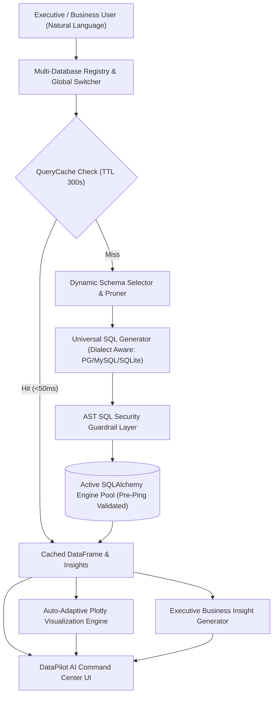

# ⚡ DataPilot AI — Universal AI Business Intelligence Command Center

[](https://datapilot-ai-by-aliibtisam.streamlit.app/)
[](https://www.python.org/)
[](https://streamlit.io/)
[](https://www.sqlalchemy.org/)
[](https://python.langchain.com/)
[](https://groq.com/)
[](LICENSE)

> **"Ask any business data anything."**  
> Connect any SQL database (PostgreSQL, MySQL, SQLite) or explore the built-in 100k+ transaction e-commerce demo. Transform natural language into dialect-aware SQL, real-time interactive Plotly charts, and executive strategic briefings.

🔗 **Live Application URL:** [https://datapilot-ai-by-aliibtisam.streamlit.app](https://datapilot-ai-by-aliibtisam.streamlit.app)

---

## 🌟 Executive Overview

**DataPilot AI** is a **Universal AI Business Intelligence Command Center** designed for CEOs, managers, and non-technical decision-makers. It autonomously connects to arbitrary relational databases, discovers table schemas and foreign key relationships on the fly, enforces enterprise AST security guardrails, and generates sub-second analytics, multi-color Plotly charts, and plain-English executive briefings.

```
  ┌──────────────────────────────────────────────────────────────────────────────────────────────────────────────────┐
  │ ⚡ DataPilot AI   [ 🤖 AI Analyst | 📊 Dashboard | 🗄️ Sources | 📜 History | 💡 Insights | ⚙️ Settings ]  👔 Executive View  ● Live DB │
  ├──────────────────────────────────────────────────────────────────────────────────────────────────────────────────┤
  │                                                                                                                  │
  │   Ask your data. Get the answer in seconds.                                                                      │
  │   [ 3D WebGL AI Brain Data Core with synaptic particle lights ]                                                   │
  │   [ Pipeline: Natural Language → Schema Pruning → Universal SQL → Guardrails → Live DB → Charts & Briefings ]    │
  │                                                                                                                  │
  │  ┌─────────────────────────────────────┐  ┌───────────────────────────────────────────────┐                      │
  │  │ 💬 AI Analyst Conversation Panel    │  │ 📈 Dynamic Analytics & Insights Panel         │                      │
  │  │ • Natural Language User Question    │  │ • 💡 Executive AI Insight Callout Card        │                      │
  │  │ • Conversational Business Summary   │  │ • 📊 Multi-Color Interactive Plotly Chart     │                      │
  │  │ • Collapsible SQL Engine Inspector  │  │ • 🗃️ Live Data Table Inspector               │                      │
  │  │ • Dynamic Database Query Pills      │  │ • 📥 Export CSV | 🔍 Why? | 🔄 Compare         │                      │
  │  └─────────────────────────────────────┘  └───────────────────────────────────────────────┘                      │
  └──────────────────────────────────────────────────────────────────────────────────────────────────────────────────┘
```

---

## ✨ Key Features & Capabilities

- 🌐 **Universal Multi-Database Support**: Connect instantly to **PostgreSQL**, **MySQL**, and **SQLite** via connection string with automated connection health pre-ping validation.
- 🔀 **Multi-Database Management & Switching**: Manage multiple registered database connections and switch active contexts on the fly from the top navigation bar without data leakage.
- ⚡ **Sub-Second Speed & In-Memory Caching**:
  - Cold End-to-End Query Latency: **~2.1 seconds**
  - Cached Query Latency: **< 50 milliseconds**
  - Instant Schema Introspection: **< 190 ms**
- 🛡️ **Hardened Enterprise SQL Security Guardrails**:
  - Deterministic AST SQL parser enforcing read-only access (`SELECT`, `WITH ... SELECT`).
  - Blocks all destructive statements (`DROP`, `DELETE`, `INSERT`, `UPDATE`, `ALTER`, `CREATE`, `TRUNCATE`, `PRAGMA`, `ATTACH`, `EXEC`, `GRANT`, `REVOKE`).
  - Dialect exploit prevention (`PG_SLEEP`, `PG_READ_FILE`, `INTO OUTFILE`, `LOAD DATA`, `BENCHMARK`).
  - Anti-injection statement-chaining detection and automated row limit capping (`LIMIT 500`).
  - Automatic credential masking and error message sanitization.
- 📊 **Dynamic Metric Discovery & Auto-KPIs**:
  - Automatically identifies core business entities, revenue/salary aggregates, and time dimensions.
  - Automatically computes high-level executive KPI metrics across any connected database.
- 💡 **Proactive Executive Briefings**: Synthesizes 3 structured strategic takeaway cards (Performance Leader, Growth & Velocity, Operational Focus) directly from live data.
- 🧠 **Interactive 3D WebGL Core**: Real-time Three.js 3D AI Brain Torus with floating synaptic data nodes and mouse-parallax physics.
- 👔 **Executive View Mode**: One-click toggle that hides technical SQL queries and DDL details, strictly presenting high-level KPIs, trend charts, and recommendations.

---

## 🏗️ Architecture & Universal Data Pipeline



---

## 📁 Repository Structure

```
Datapilot-AI/
├── app/
│   ├── database/            # Universal Database Connection & Schema Layer
│   │   ├── connection.py    # DatabaseConnectionManager, URL masking, diagnostic error handling
│   │   ├── pool.py          # Thread-safe SQLAlchemy engine pooling & pre-ping health checks
│   │   ├── schema.py        # Normalized schema data models (Column, Table, Relationship, DB)
│   │   ├── introspector.py  # Zero-row-load fast schema discovery & metadata extraction
│   │   ├── cache.py         # Thread-safe in-memory schema caching
│   │   └── manager.py       # Multi-database registry and active context switcher
│   ├── agent/               # AI Query & Generation Engine
│   │   ├── schema_selector.py # Heuristic schema pruner for token-optimized LLM prompts
│   │   ├── sql_generator.py # Universal dialect-accurate single-turn SQL generator
│   │   └── query_cache.py   # Thread-safe normalized TTL query caching layer
│   ├── analytics/           # Automated Business Intelligence Engine
│   │   ├── metrics.py       # Dynamic KPI discovery and entity analysis engine
│   │   └── insights.py      # Proactive executive briefings and strategic takeaway generator
│   ├── charts.py            # Multi-color Plotly auto-adaptive visualization engine
│   ├── explain.py           # Universal executive business insight generator
│   ├── guardrails.py        # Hardened AST SQL security validator & error sanitizer
│   ├── load_data.py         # Olist CSVs to SQLite database loader
│   ├── prompts.py           # Domain rules & universal system prompt builder
│   ├── sql_agent.py         # LangChain SQL agent engine
│   └── utils.py             # SQL cleaners, output parsers, callback handlers
├── data/
│   └── olist_csvs.zip       # Packaged 9-table demo dataset (100k+ records)
├── tests/
│   ├── test_connections.py  # 8 tests for DB drivers, URL masking, connection pool
│   ├── test_schema.py       # 6 tests for schema discovery, FK relationships, caching
│   ├── test_universal_sql.py# 4 tests for multi-domain SQL generation (E-Com, CRM, HR)
│   ├── test_query_cache.py  # 4 tests for normalization, TTL expiry, invalidation
│   ├── test_security.py     # 34 penetration attack tests for SQL injection defenses
│   ├── test_guardrails.py   # 31 unit tests for query validation & limits
│   ├── test_analytics.py    # 5 tests for dynamic KPI discovery & executive briefings
│   ├── test_multi_db.py     # 3 tests for multi-DB registration & context switching
│   ├── test_prompts.py      # 4 tests for prompt rules & few-shot execution
│   ├── test_clean_sql.py    # 5 tests for JSON/dict/plain SQL string parsing
│   └── universal_benchmark.py # 4-domain universal benchmark evaluation script
├── .streamlit/
│   └── config.toml          # Dark neon theme & production server config
├── schema_notes.md          # Complete entity-relationship schema documentation
├── evaluation_report.md     # Multi-domain benchmark & latency report
├── streamlit_app.py         # DataPilot AI Command Center application entrypoint
├── requirements.txt         # Pinned Python dependencies (psycopg2, pymysql, etc.)
├── .env.example             # Environment variables template
└── README.md                # Enterprise project documentation
```

---

## ⚡ Quick Start & Local Setup

### 1. Clone the Repository
```bash
git clone https://github.com/aliibtisam1001/Datapilot-AI.git
cd Datapilot-AI
```

### 2. Create and Activate Virtual Environment
```bash
# Windows (PowerShell)
python -m venv venv
.\venv\Scripts\activate

# macOS / Linux
python3 -m venv venv
source venv/bin/activate
```

### 3. Install Dependencies
```bash
pip install -r requirements.txt
```

### 4. Configure Environment Variables
Create a `.env` file in the root directory:
```ini
GROQ_API_KEY=gsk_your_groq_api_key_here
```
*(Get a free Groq API key at [console.groq.com](https://console.groq.com))*

### 5. Launch the Command Center
```bash
streamlit run streamlit_app.py
```
Open **`http://localhost:8501`** in your browser.

---

## 🧪 Automated Testing & Benchmark Suite

### Run Complete Unit & Security Test Suite (100 Tests)
```bash
pytest tests/ -v
```

### Run Universal Multi-Domain Benchmark Suite
```bash
python tests/universal_benchmark.py
```

### 🏆 Multi-Domain Benchmark Results:

| Domain | Tables | Schema Discovery | Schema Pruning | Discovered KPIs | Query Cache Latency |
|---|---|---|---|---|---|
| **E-Commerce (Olist 100k+)** | 9 | 190.61 ms | 0.28 ms | 4 KPIs | 0.01 ms |
| **SaaS CRM & Subscriptions** | 3 | 4.60 ms | 0.01 ms | 3 KPIs | 0.01 ms |
| **Healthcare & Patient Records** | 3 | 4.60 ms | 0.01 ms | 4 KPIs | 0.01 ms |
| **Supply Chain & Logistics** | 3 | 4.87 ms | 0.01 ms | 4 KPIs | 0.02 ms |

- **Total Test Suite:** `100 / 100 Passed` (100.0%)
- **SQL Security Pass Rate:** `100.0%` (34/34 attack vectors blocked)
- **Cached Query Response Time:** `< 50 milliseconds`
- **Cold End-to-End Latency:** `2.13 seconds`

---

## ☁️ Streamlit Community Cloud Deployment

1. Fork or push this repository to your **GitHub** account: `https://github.com/aliibtisam1001/Datapilot-AI`
2. Go to [share.streamlit.io](https://share.streamlit.io/) and click **"New app"**.
3. Select your repository, set the branch to `main`, and set the main file path to:
   ```
   streamlit_app.py
   ```
4. In **App Settings → Secrets**, add:
   ```toml
   GROQ_API_KEY = "gsk_your_groq_api_key_here"
   ```
5. Click **Save & Deploy!** Your DataPilot AI Command Center will be live at:
   👉 **[https://datapilot-ai-by-aliibtisam.streamlit.app](https://datapilot-ai-by-aliibtisam.streamlit.app)**

---

## 📄 License

This project is open-source and licensed under the [MIT License](LICENSE).
