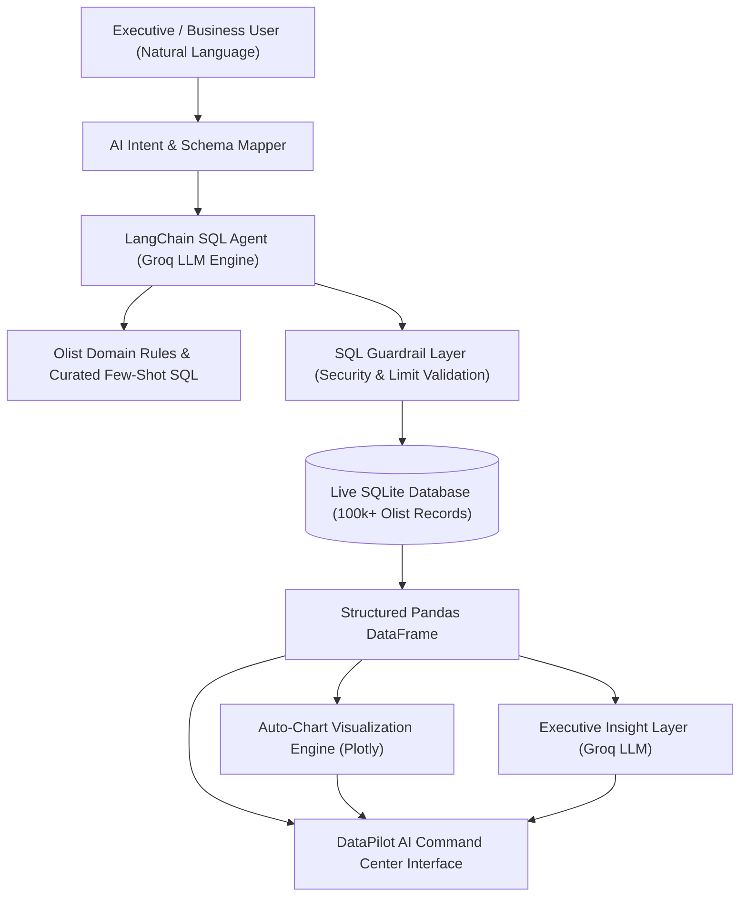

# ⚡ DataPilot AI — Futuristic AI Business Intelligence Command Center

[](https://www.python.org/)
[](https://streamlit.io/)
[](https://python.langchain.com/)
[](https://groq.com/)
[](LICENSE)

> **"Ask your business data anything."**  
> Turn plain English into real-time business intelligence without writing SQL, building complex dashboards, or requiring technical database analysis.

---

## 🌟 Executive Overview

**DataPilot AI** is an enterprise-grade AI Business Intelligence Command Center designed for CEOs, managers, and non-technical business leaders. It translates natural language questions into secure, optimized SQL queries, runs them against a live 100,000+ transaction database, and dynamically generates multi-color interactive visualizations, structured data tables, and plain-English executive insights.

```
  ┌──────────────────────────────────────────────────────────────────────────────────────────┐
  │ ⚡ DataPilot AI                    [ AI Analyst | Dashboard | Sources | History | Insights ]  👔 Executive View  ● Live DB │
  ├──────────────────────────────────────────────────────────────────────────────────────────┤
  │                                                                                          │
  │   Ask your data. Get the answer.                                                         │
  │   [ 3D WebGL AI Brain Data Core with synaptic particle lights ]                           │
  │   [ Pipeline: Question → Intent → SQL Generated → Live DB → Charts → Business Insights ] │
  │                                                                                          │
  │  ┌─────────────────────────────────────┐  ┌───────────────────────────────────────────┐  │
  │  │ 💬 AI Analyst Conversation Panel    │  │ 📈 Dynamic Analytics & Insights Panel     │  │
  │  │ • Natural Language User Question    │  │ • 💡 Executive AI Insight Callout Card    │  │
  │  │ • Conversational Business Summary   │  │ • 📊 Multi-Color Interactive Plotly Chart │  │
  │  │ • Collapsible SQL Engine Inspector  │  │ • 🗃️ Live Data Table Inspector           │  │
  │  │ • Follow-up quick queries           │  │ • 📥 Export CSV | 🔍 Why? | 🔄 Compare     │  │
  │  └─────────────────────────────────────┘  └───────────────────────────────────────────┘  │
  └──────────────────────────────────────────────────────────────────────────────────────────┘
```

---

## ✨ Key Features & Capabilities

- 🤖 **Natural Language to SQL**: Ask any business question in plain English (e.g. *"What are the top 5 product categories by revenue in 2018?"*).
- 🧠 **Interactive 3D WebGL Core**: Real-time Three.js 3D AI Brain Torus with floating synaptic data nodes and mouse-parallax physics.
- 👔 **Executive View Mode**: One-click toggle that hides technical SQL queries and DDL details, strictly displaying high-level business KPIs, trend charts, executive summaries, and recommendations.
- 🛡️ **SQL Security Guardrail Layer**: Deterministic AST-based SQL validator rejecting destructive queries (`DROP`, `DELETE`, `INSERT`, `UPDATE`, `ALTER`), blocking multi-statement chaining/injection, and enforcing row limits.
- 📊 **Auto-Adaptive Visualizations**: Multi-color Plotly chart engine automatically selecting the optimal chart type (KPI cards, vertical/horizontal bar charts, time-series line graphs, or data tables) with smooth entry transitions.
- 💡 **Executive Business Insights**: Generates clear, 2–3 sentence executive summaries detailing key revenue drivers, growth comparisons, and operational recommendations.
- 🔄 **Multi-Model Fault Tolerance**: Automatic multi-model fallback across `openai/gpt-oss-120b`, `openai/gpt-oss-20b`, and `qwen/qwen3.6-27b` on Groq to guarantee zero 429 rate-limit interruptions.
- 🗄️ **Live Schema Visualizer**: Interactive database explorer with table counts and column schemas across 9 relational tables.

---

## 🏗️ Architecture & Data Pipeline



---

## 📊 Connected Dataset (Olist Brazilian E-Commerce)

The application operates on a real-world production dataset of 100,000+ orders from Olist Store in Brazil:

| Table Name | Description | Rows | Primary Keys / Foreign Keys |
|---|---|---|---|
| `orders` | Order transactions, delivery dates & statuses | 99,441 | `order_id`, `customer_id` |
| `order_items` | Products per order, price, and freight fees | 112,650 | `order_id`, `order_item_id`, `product_id` |
| `products` | Product dimensions, categories, and photos | 32,951 | `product_id`, `product_category_name` |
| `customers` | Customer states, cities, and unique IDs | 99,441 | `customer_id`, `customer_unique_id` |
| `sellers` | Seller locations, cities, and states | 3,095 | `seller_id`, `seller_zip_code_prefix` |
| `order_payments` | Payment methods, installments, amounts | 103,886 | `order_id`, `payment_type` |
| `order_reviews` | Review scores (1–5) and customer feedback | 99,224 | `review_id`, `order_id` |
| `geolocation` | Zip code coordinates and geographic states | 1,000,163 | `geolocation_zip_code_prefix` |
| `product_category_name_translation` | Portuguese to English category translations | 71 | `product_category_name` |

---

## 📁 Repository Structure

```
Datapilot-AI/
├── app/
│   ├── __init__.py
│   ├── charts.py            # Multi-color Plotly auto-adaptive visualization engine
│   ├── explain.py           # Plain-English executive business insight generator
│   ├── guardrails.py        # Deterministic SQL validation & security guardrails
│   ├── load_data.py         # CSV to SQLite database builder & schema integrity
│   ├── prompts.py           # Domain rules & few-shot SQL query examples
│   ├── sql_agent.py         # LangChain SQL agent engine
│   ├── test_db_connection.py# Database connectivity verification test
│   └── utils.py             # SQL extraction and LangChain callback handlers
├── tests/
│   ├── benchmark_eval.py    # Automated 10-test end-to-end evaluation suite
│   ├── test_guardrails.py   # 31 unit tests for SQL security & injection defenses
│   ├── test_prompts.py      # 4 unit tests for prompt rules & few-shot execution
│   └── test_groq_api.py     # Groq API connection test
├── .streamlit/
│   └── config.toml          # Dark neon theme & production server config
├── schema_notes.md          # Complete entity-relationship schema documentation
├── evaluation_report.md     # 10-test benchmark evaluation report (100% pass rate)
├── streamlit_app.py         # DataPilot AI Command Center application entrypoint
├── index.html               # Standalone presentation landing page
├── requirements.txt         # Pinned Python dependencies
├── .env.example             # Environment variables template
├── .gitignore               # Clean repository git ignore rules
└── README.md                # Enterprise project documentation
```

---

## ⚡ Quick Start & Local Setup

### 1. Clone the Repository
```bash
git clone https://github.com/aliibtisam1001/Datapilot-AI.git
cd Datapilot-AI
```

### 2. Create and Activate Virtual Environment
```bash
# Windows (PowerShell)
python -m venv venv
.\venv\Scripts\activate

# macOS / Linux
python3 -m venv venv
source venv/bin/activate
```

### 3. Install Dependencies
```bash
pip install -r requirements.txt
```

### 4. Configure Environment Variables
Create a `.env` file in the root directory:
```ini
GROQ_API_KEY=gsk_your_groq_api_key_here
```
*(Get a free Groq API key at [console.groq.com](https://console.groq.com))*

### 5. Launch the Command Center
```bash
streamlit run streamlit_app.py
```
Open **`http://localhost:8501`** in your browser.

---

## 🧪 Automated Testing & Benchmark Suite

### Run SQL Security Guardrail Unit Tests (31 Tests)
```bash
pytest tests/test_guardrails.py -v
```

### Run Prompt Rules & Few-Shot Validation Tests (4 Tests)
```bash
pytest tests/test_prompts.py -v
```

### Run End-to-End Automated Benchmark (10 Test Cases)
```bash
python tests/benchmark_eval.py
```

### 🏆 Benchmark Results:
- **Overall Execution Score:** `100.0%` (10/10 test cases passed)
- **SQL Guardrail Compliance:** `100.0%` (0 invalid statements allowed)
- **Visualization Generation:** `100.0%`
- **Average Response Latency:** `3.86 seconds`
*(Full details in [evaluation_report.md](evaluation_report.md))*

---

## ☁️ Streamlit Community Cloud Deployment

1. Push this repository to **GitHub**: `https://github.com/aliibtisam1001/Datapilot-AI`
2. Go to [share.streamlit.io](https://share.streamlit.io/) and click **"New app"**.
3. Select your repository, set the branch to `main` (or `master`), and set the main file path to:
   ```
   streamlit_app.py
   ```
4. In **Advanced Settings -> Secrets**, add:
   ```toml
   GROQ_API_KEY = "gsk_your_groq_api_key_here"
   ```
5. Click **Deploy!** Your DataPilot AI Command Center will be live on the web.

---

## 💡 Example Queries to Test

- *"What is the total revenue from delivered orders?"*
- *"What are the top 5 product categories by revenue in English?"*
- *"Which 5 states have the most customers?"*
- *"How many orders were placed each month in 2018?"*
- *"What is the average delivery time in days for delivered orders?"*
- *"What percentage of orders were canceled?"*
- *"Which payment method generates the highest revenue?"*
- *"What is the average review score across all delivered orders?"*

---

## 📄 License

This project is open-source and licensed under the [MIT License](LICENSE).
