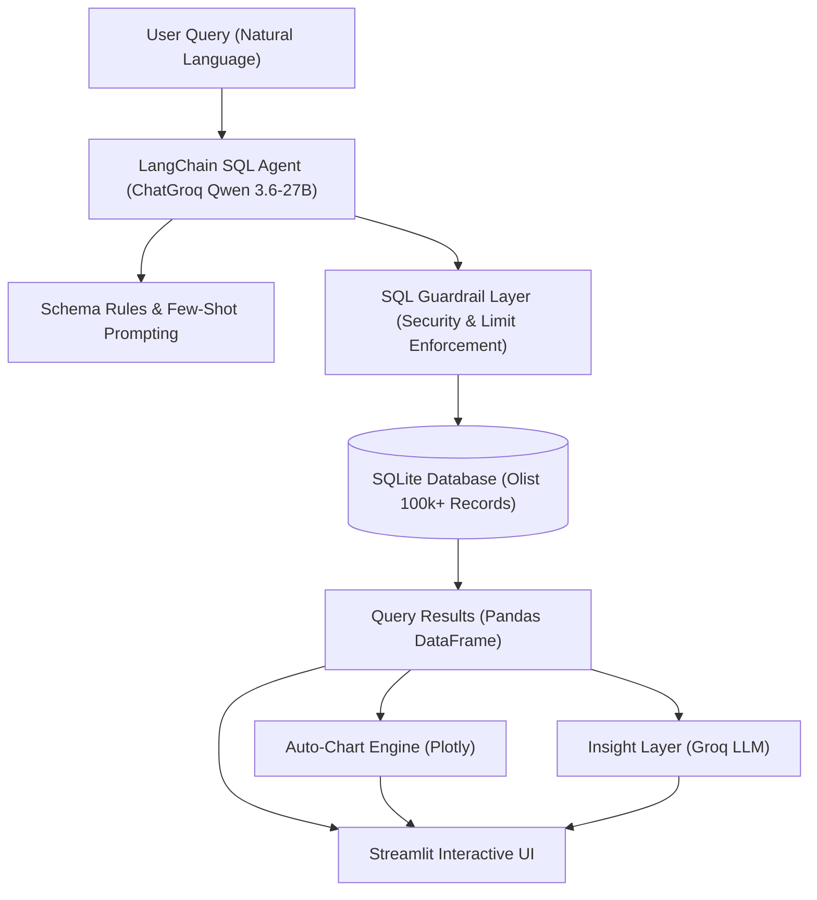

# 🔍 SmartQuery — Natural Language Business Intelligence Assistant

[](https://www.python.org/)
[](https://streamlit.io/)
[](https://python.langchain.com/)
[](https://groq.com/)
[](LICENSE)

**SmartQuery** is an AI-powered business intelligence assistant that converts natural language business questions into optimized SQLite queries, executes them safely against a 100,000+ order e-commerce dataset, and delivers instant interactive visualizations, formatted data tables, and plain-English executive insights.

---

## 🌟 Key Features

- 💬 **Natural Language to SQL**: Ask complex business questions in plain English (e.g. *"What are the top 5 product categories by revenue in 2018?"*).
- 🛡️ **SQL Guardrail Layer**: Strict security engine that blocks destructive queries (`DROP`, `DELETE`, `INSERT`, `UPDATE`), catches multi-statement injections, and enforces automatic row limits.
- 📊 **Auto-Adaptive Visualizations**: Automatically selects the best Plotly chart based on result structure (KPI metric indicators, horizontal/vertical bar charts, time-series line graphs, or data tables).
- 💡 **AI Business Explanations**: Summarizes query findings into 2–3 sentence executive summaries with specific numbers and actionable takeaways.
- 🧠 **Schema-Aware Prompting**: Injects Olist domain rules and curated few-shot examples into the LangChain agent for 100% accurate joins, category translations, and date arithmetic.
- 🚀 **Streamlit Cloud Ready**: Zero-configuration deployment on Streamlit Community Cloud with secret management and dynamic API key support.

---

## 🏗️ Architecture & Data Pipeline



---

## 📊 Dataset Overview (Olist Brazilian E-Commerce)

The application queries a real-world dataset of 100,000+ orders made at Olist Store in Brazil between 2016 and 2018:

| Table Name | Description | Rows |
|---|---|---|
| `orders` | Central order transactions & statuses | 99,441 |
| `order_items` | Items purchased per order, price, freight | 112,650 |
| `products` | Product dimensions, categories, and IDs | 32,951 |
| `customers` | Customer locations & unique IDs | 99,441 |
| `sellers` | Seller locations and seller IDs | 3,095 |
| `order_payments` | Payment methods, installments, amounts | 103,886 |
| `order_reviews` | Review scores (1–5) and review timestamps | 99,224 |
| `geolocation` | Zip code coordinates and states | 1,000,163 |
| `product_category_name_translation` | Portuguese to English category mappings | 71 |

---

## 📁 Repository Structure

```
SmartQuery/
├── app/
│   ├── __init__.py
│   ├── charts.py            # Auto-adaptive Plotly visualization engine
│   ├── explain.py           # Plain-English executive insight generator
│   ├── guardrails.py        # SQL validation & security guardrails
│   ├── load_data.py         # CSV to SQLite database builder
│   ├── prompts.py           # Schema rules & few-shot query examples
│   ├── sql_agent.py         # Standalone LangChain SQL agent module
│   └── utils.py             # Shared SQL extraction and callback handlers
├── data/
│   ├── olist.db             # SQLite database (100k+ records)
│   └── *.csv                # Source Olist CSV datasets
├── tests/
│   ├── benchmark_eval.py    # End-to-end 10-test automated benchmark
│   ├── test_guardrails.py   # 31 unit tests for SQL security guardrails
│   ├── test_prompts.py      # 4 unit tests for prompt engineering & few-shots
│   └── test_groq_api.py     # Groq API connection test
├── .streamlit/
│   └── config.toml          # Streamlit theme & production server config
├── schema_notes.md          # Full entity-relationship schema documentation
├── evaluation_report.md     # Benchmark evaluation report (100% pass rate)
├── streamlit_app.py         # Streamlit chat user interface entrypoint
├── requirements.txt         # Pinned Python package dependencies
├── .env.example             # Example environment variables template
└── README.md                # Project documentation
```

---

## ⚡ Quick Start & Local Setup

### 1. Clone the Repository
```bash
git clone https://github.com/your-username/SmartQuery.git
cd SmartQuery
```

### 2. Create and Activate Virtual Environment
```bash
# Windows
python -m venv venv
.\venv\Scripts\activate

# macOS / Linux
python3 -m venv venv
source venv/bin/activate
```

### 3. Install Dependencies
```bash
pip install -r requirements.txt
```

### 4. Configure API Key
Create a `.env` file in the root directory:
```ini
GROQ_API_KEY=gsk_your_groq_api_key_here
```
*(Get a free Groq API key at [console.groq.com](https://console.groq.com))*

### 5. Launch the Streamlit App
```bash
streamlit run streamlit_app.py
```
Open your browser at `http://localhost:8501`.

---

## 🧪 Running Automated Tests & Benchmark

### Run SQL Guardrail Unit Tests (31 Tests)
```bash
pytest tests/test_guardrails.py -v
```

### Run Prompt & Few-Shot Validation Tests (4 Tests)
```bash
pytest tests/test_prompts.py -v
```

### Run End-to-End Evaluation Benchmark (10 Test Cases)
```bash
python tests/benchmark_eval.py
```

### Benchmark Results Summary:
- **Overall Pass Rate:** `100.0%` (10/10)
- **SQL Guardrail Compliance:** `100.0%`
- **Auto-Chart Generation:** `100.0%`
- **Average Response Latency:** `3.86 seconds`
*(Full details in [evaluation_report.md](evaluation_report.md))*

---

## ☁️ Deploying to Streamlit Community Cloud

1. Push your repository to **GitHub**.
2. Visit [share.streamlit.io](https://share.streamlit.io/) and click **"New app"**.
3. Select your repository, branch (`master` or `main`), and set the main file path to:
   ```
   streamlit_app.py
   ```
4. In **Advanced Settings -> Secrets**, add:
   ```toml
   GROQ_API_KEY = "gsk_your_groq_api_key_here"
   ```
5. Click **Deploy!** Your SmartQuery BI Assistant will be live.

---

## 💡 Example Business Questions to Try

- *"What is the total revenue from delivered orders?"*
- *"What are the top 5 product categories by revenue in English?"*
- *"Which 5 states have the most customers?"*
- *"How many orders were placed each month in 2018?"*
- *"What is the average delivery time in days for delivered orders?"*
- *"What percentage of orders were canceled?"*
- *"Which payment method generates the highest revenue?"*
- *"How many repeat customers do we have?"*

---

## 📄 License

This project is licensed under the MIT License — see the [LICENSE](LICENSE) file for details.
